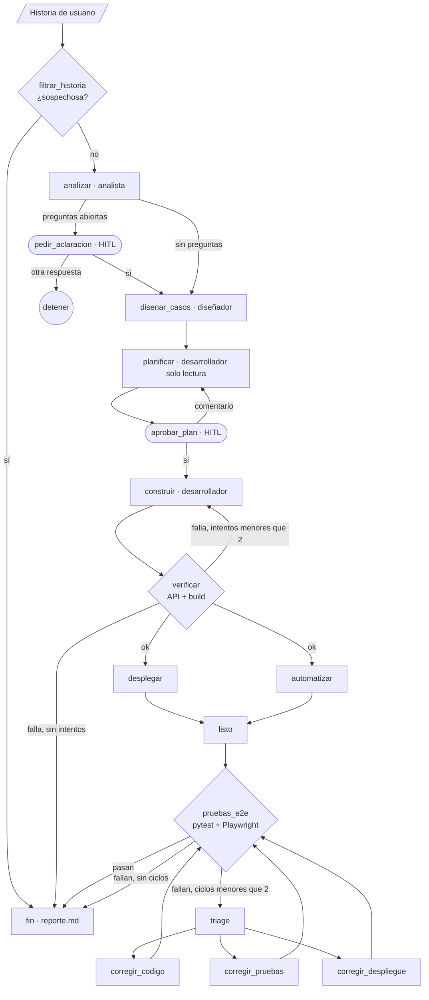

# Fábrica de software con agentes · Módulo 3

Una cadena de agentes que convierte una historia de usuario en una aplicación de gestión de empleados (base de datos, API y front-end) desplegada y probada de punta a punta. El orden de las etapas lo fija un grafo de LangGraph. Cada paso de un agente termina en una verificación determinista: **el código decide si el paso se cumplió, no el agente**. Hay una persona en el bucle para las preguntas abiertas y la aprobación del plan.

La última historia construida con la fábrica es **HU-10 · Solicitar vacaciones** (ver el [ejemplo completo](#ejemplo-completo-hu-10)).

## Flujo (sesión 4)



`desplegar` y `automatizar` corren **en paralelo** y se unen en `listo`. El triage tiene como máximo `MAX_CICLOS = 2` ciclos de corrección. El diagrama que genera el propio grafo está en `flujos/salidas/grafo_flujo_s4.html`.

## Agentes y roles

| Rol de la rúbrica | Pieza de la fábrica | Tipo | Herramientas | Puede escribir | Programas en la terminal |
|---|---|---|---|---|---|
| Filtro de seguridad | `filtrar_historia` (`flujos/flujo_s4.py`) | 1 llamada a un LLM con salida estructurada | ninguna | nada | ninguno |
| Analista | `agentes/analista.py` | agente (bucle de `base.py`) | `leer_archivo`, `listar_archivos`, `escribir_archivo` | `salida/HU-xx/` (lee `historias/` y `contexto/`) | ninguno |
| Tester (diseño) | `agentes/disenador_pruebas.py` | agente (bucle de `base.py`) | leer y listar, `guardar_casos` (por lotes, validado con Pydantic) | `salida/HU-xx/casos_prueba.json` | ninguno |
| Planificador | `desarrollador.planificar` | agente (Claude Code) | `Read`, `Glob`, `Grep` (solo lectura) | nada | ninguno |
| Codificador | `desarrollador.construir` | agente (Claude Code) | `Read`, `Glob`, `Grep`, `Write`, `Edit`, `Bash` | `backend/*`, `frontend/*` | `cd ls cat mkdir npm npx node python python3 curl sleep kill` |
| Despliegue | `agentes/despliegue.py` | agente (Claude Code) | los mismos de edición | `docker-compose.yml`, Dockerfiles, `.dockerignore`, `nginx.conf` | `cd ls cat docker curl sleep` |
| Tester (automatización) | `agentes/automatizador.py` | agente (Claude Code) | los mismos de edición | `tests/*` | `cd ls cat python python3 pytest` |
| Reviewer | `flujos/verificacion.py` y `agentes/triage.py` | código determinista + 1 llamada a un LLM (triage) | ninguna | nada | — |

Los agentes de Claude Code trabajan con `cwd=app/` y no tienen `WebFetch` ni `WebSearch`. Los permisos de escritura, lectura y programas los imponen los hooks de `seguridad/hooks.py`, no el prompt.

## Requisitos

Python 3.12 (fijado en `.python-version`), Node 20 o superior, Docker Desktop, Claude Code y una clave de API de Anthropic con créditos.

## Instalación

**Mac o Linux**

```bash
uv venv && source .venv/bin/activate        # o: python3.12 -m venv .venv
uv pip install -r requirements.txt          # o: pip install -r requirements.txt
playwright install chromium
cp .env.example .env                        # y escribe los valores
docker info > /dev/null && echo "Docker listo"
```

**Windows (PowerShell)**

```powershell
py -3.12 -m venv .venv
.venv\Scripts\Activate.ps1                  # si lo bloquea: Set-ExecutionPolicy -Scope CurrentUser RemoteSigned
pip install -r requirements.txt
playwright install chromium
Copy-Item .env.example .env                 # y escribe los valores
setx PYTHONUTF8 1                           # una vez; luego abre otra terminal
docker info *> $null; if ($?) { "Docker listo" }
```

### Levantar la app desde un clon nuevo

La app ya generada se levanta sin correr la fábrica ni gastar en agentes:

```bash
cd app
docker compose up -d --build      # construye backend (python:3.12-slim) y frontend (node:22 → nginx)
docker compose ps                 # backend «healthy» en unos 12 s
curl -s http://localhost:8080/api/salud     # {"estado":"ok"}
python -m pytest tests -q         # 57 passed, 2 skipped (con el entorno de Python activado)
```

La base empieza vacía: `backend/datos/` no se versiona y Docker la crea al arrancar. Los datos persisten entre `docker compose down` y `up`. `docker compose down -v` no los borra, porque son un bind mount; para empezar de cero hay que borrar `app/backend/datos/`. En Linux esa carpeta queda como propiedad de root, así que hace falta `sudo`.

### Variables de `.env`

| Variable | Para qué |
|---|---|
| `ANTHROPIC_API_KEY` | Clave de la API de Anthropic. `.env` no se versiona. |
| `MODEL` | Modelo que usan todos los agentes (nunca se escribe fijo en el código). |
| `PRESUPUESTO_USD` | Tope de gasto por cada llamada a Claude Code (`max_budget_usd`). |
| `DEFENSAS` | `1` activa el filtro de historia y los hooks de seguridad. **Nunca 0 en el reto.** |

Variables opcionales al ejecutar: `REANUDAR=<thread_id>` (retoma un hilo) y `URL_API` / `URL_WEB` (para las pruebas; por defecto `http://localhost:8000` y `http://localhost:8080`).

## Cómo correr una historia

```bash
python -m flujos.flujo_s4 historias/HU-10-solicitar-vacaciones.md
# guardar la salida como evidencia:
PYTHONUNBUFFERED=1 python -m flujos.flujo_s4 historias/HU-10-solicitar-vacaciones.md 2>&1 | tee evidencias/ejecucion_HU-10.log
```

```powershell
$env:PYTHONUNBUFFERED=1; python -m flujos.flujo_s4 historias\HU-10-solicitar-vacaciones.md 2>&1 | Tee-Object evidencias\ejecucion_HU-10.log
```

Qué vas a ver:
- Al inicio, el hilo: `[11:13:29] Hilo HU-10-solicitar-vacaciones-20261105-1113 · para retomarlo: REANUDAR=…`.
- Una línea por nodo: `[HH:MM:SS] nodo → claves actualizadas`.
- Dos posibles pausas humanas:
  - **Preguntas abiertas:** escribe exactamente `si` para continuar; cualquier otra respuesta detiene el flujo.
  - **Aprobación del plan:** `si` lo aprueba; cualquier otro texto lo rechaza y se manda como comentario para el siguiente plan. Va en **una sola línea**.

Lo que deja en `salida/HU-xx/`:
- `criterios.feature` y `casos_prueba.json`;
- `plan.md`, con cada versión del plan y la decisión humana;
- `reporte.md`, con el estado final y la bitácora con hora;
- `historial_estados.md`, con los checkpoints;
- `resultados.xml`.

### Retomar un hilo con `REANUDAR`

Los checkpoints se guardan en `.langgraph/checkpoints.sqlite` (SqliteSaver). Si se cerró la terminal o un nodo falló, el flujo retoma desde el último checkpoint, sin repetir lo que ya se hizo:

```bash
REANUDAR=HU-10-solicitar-vacaciones-20261105-1113 python -m flujos.flujo_s4
```

```powershell
$env:REANUDAR="HU-10-solicitar-vacaciones-20261105-1113"; python -m flujos.flujo_s4; Remove-Item Env:REANUDAR
```

Si el hilo estaba en una pausa, vuelve a hacer la pregunta; si se cortó a mitad de un nodo, sigue desde ese nodo.

### Otros comandos

```bash
python -m agentes.analista historias/HU-01-registrar-empleado.md      # un agente suelto
python -m agentes.disenador_pruebas salida/HU-01/criterios.feature
python -m flujos.regenerar_pruebas HU-02     # rehace las pruebas de una historia con el automatizador actual
python -m flujos.flujo_s2 historias/HU-01-registrar-empleado.md      # versiones de las sesiones 2 y 3
```

## Pruebas

```bash
(cd app && python -m pytest tests -q)          # app: API (httpx) y E2E (Playwright), con la app arriba
python -m pytest tests_fabrica -v              # fábrica: validadores, sin LLM ni red
python evidencias/capturas.py                  # capturas de pantalla de HU-10 en evidencias/capturas/
```

`ejecutar_pruebas` (en `flujos/verificacion.py`) corre toda la suite e indica cuántas pruebas son de la historia y cuántas de regresión, por ejemplo `Pruebas de HU-10: 24 (0 fallan) · Regresión: 35 (0 fallan)`.

## Seguridad y `DEFENSAS`

- **Contenido no confiable:** `filtrar_historia` revisa la historia dentro de `<historia_no_confiable>` antes de que la lea cualquier agente. Si es sospechosa, el flujo va directo al reporte (`salida/bloqueada/reporte.md`, estado «BLOQUEADA POR SEGURIDAD»).
- **Hooks** (`seguridad/hooks.py`):
  - de rol, siempre activos: `confinar_escritura`;
  - de seguridad, con `DEFENSAS=1`: `confinar_lectura` (no sale de `app/` ni lee `.env` o `secretos`), `comandos_permitidos` (solo los programas de cada agente, sin `$(...)` ni `printenv` o `environ`) y `auditar` (una línea por llamada en `auditoria.jsonl`).
- **Límites:** `max_pasos` (bucle de `base.py`), `max_turns=80` y `PRESUPUESTO_USD` (Claude Code), `MAX_INTENTOS=2` (construir), `MAX_CICLOS=2` (triage) y 2 intentos por validador.
- **`DEFENSAS=0`** solo se usa en clase para demostrar el ataque de HU-99. Sin defensas no hay `auditoria.jsonl`. Los ataques apuntan únicamente al señuelo `secretos_demo.txt`.
- El análisis completo está en `salida/seguridad.md`.

## Estructura

```text
agentes/           analista, diseñador, desarrollador, despliegue, automatizador, triage; base.py (bucle) y claude_code.py
contexto/          reglas de negocio y convenciones (las leen todos los agentes; convenciones_app.md → app/CLAUDE.md)
historias/         HU-01 a HU-03, HU-10 (reto), HU-99 (envenenada) y backlog.md
flujos/            flujo_s2/s3/s4 (LangGraph), verificacion.py, regenerar_pruebas.py, util.py
flujos/salidas/    diagramas HTML de los grafos
seguridad/         hooks.py (rol, lectura, comandos, auditoría)
tests_fabrica/     pruebas de los validadores de la fábrica
ejemplos/          un programa corto por patrón, para clase
app/               la aplicación que generan los agentes (no se edita a mano)
salida/            artefactos por historia (no se editan a mano, salvo seguridad.md y decisiones.md)
evidencias/        logs, capturas, notas de iteraciones y PROCESO.md
.langgraph/        checkpoints de los hilos (no se versiona)
auditoria.jsonl    auditoría de la última ejecución (entregable)
```

## Ejemplo completo: HU-10

1. **Preparar el contexto.** `historias/HU-10-solicitar-vacaciones.md`; reglas y convenciones de vacaciones anexadas a `contexto/`, más la sección «HU-10 · Compatibilidad y decisiones de implementación».
2. **Regresión en verde antes de empezar:** `python -m flujos.regenerar_pruebas HU-01` (y luego HU-02 y HU-03).
3. **Ejecutar:** `python -m flujos.flujo_s4 historias/HU-10-solicitar-vacaciones.md`.
   - `filtrar_historia` → OK; el analista escribe 13 escenarios que pasan `validar_gherkin` en el intento 1.
   - Preguntas abiertas → `si`.
   - El diseñador se cortó por `max_tokens`; se corrigió el agente (guardar por lotes) y se retomó con `REANUDAR=HU-10-solicitar-vacaciones-20261105-1113`. Quedaron 24 casos.
   - Plan v1 **rechazado** con 4 cambios concretos; plan v2 **aprobado** (`salida/HU-10/plan.md`).
   - Construcción 1 → verificación OK → despliegue ‖ automatización → E2E.
4. **Resultado:** `salida/HU-10/reporte.md` en **LISTA**, 0 ciclos de corrección, 1.84 USD, `57 passed, 2 skipped`.
5. **Probarlo a mano:** http://localhost:8080 → «Solicitar vacaciones» en un empleado activo → del 2026-12-21 al 2026-12-31 → «Solicitud registrada: 8 días hábiles. Te quedan 4 días hábiles en 2026.»

```bash
curl -s -X POST http://localhost:8080/api/empleados/<id>/vacaciones \
     -H 'Content-Type: application/json' -d '{"fecha_inicio":"2026-12-21","fecha_fin":"2026-12-31"}'
```

## Troubleshooting

| Síntoma | Causa | Qué hacer |
|---|---|---|
| `<agente>: la respuesta se cortó por max_tokens` | La salida no cabe en una respuesta | Pedir una salida más corta. En el diseñador se resolvió guardando por lotes. Luego retoma con `REANUDAR` |
| La ejecución se cortó en la aprobación del plan | Se cerró la terminal | `REANUDAR=<thread_id> python -m flujos.flujo_s4` |
| La pausa terminó el flujo | Se respondió algo distinto de `si` a las preguntas abiertas | Volver a ejecutar y responder exactamente `si` |
| `attempt to write a readonly database` | Una prueba escribe en el SQLite del host | El automatizador ya prohíbe tocar la base; `python -m flujos.regenerar_pruebas HU-xx` |
| Al regenerar, las mismas pruebas siguen fallando | El agente edita los archivos que ya existen sin revisarlos | `regenerar_pruebas` le devuelve sus fallas una vez; si persiste, revisa la falla y corrige las instrucciones del agente |
| `Locator.select_option: Timeout` | La prueba elige una opción que el `<select>` no tiene | Departamentos válidos; si el caso es inalcanzable desde la UI, `skip` con motivo |
| «El escenario N no tiene 'Dado'» | Se usó `Antecedentes` o `Esquema del escenario` | Lo prohíbe el prompt del analista; reintenta |
| `no such column` | Alguien agregó una columna a `empleados` | Rechaza el plan; último recurso: `cd app && docker compose down -v` (borra datos) |
| Puerto 8000 ocupado | Un uvicorn viejo | `lsof -i :8000` y `kill <pid>` (Windows: `netstat -ano \| findstr :8000` y `taskkill /PID <n> /F`); luego `docker compose up -d` |
| `Cannot connect to the Docker daemon` | Docker Desktop cerrado | Ábrelo y espera a que `docker info` responda |
| El filtro bloquea una historia legítima | Falso positivo | Lee el motivo en el reporte y ajusta el prompt de `filtrar_historia` |
| Se acaba el presupuesto al construir | `PRESUPUESTO_USD` bajo | Súbelo en `.env` (por ejemplo, 5) |
| `auditoria.jsonl` no cambia | Se corrió con `DEFENSAS=0` | Es lo esperado: la auditoría es una defensa |
| `UnicodeEncodeError` (Windows) | Falta UTF-8 | `setx PYTHONUTF8 1` y abre otra terminal |
| `⚠ claude.ai connectors are disabled…` | Claude Code usa `ANTHROPIC_API_KEY` | Inofensivo: los agentes no usan connectors |
